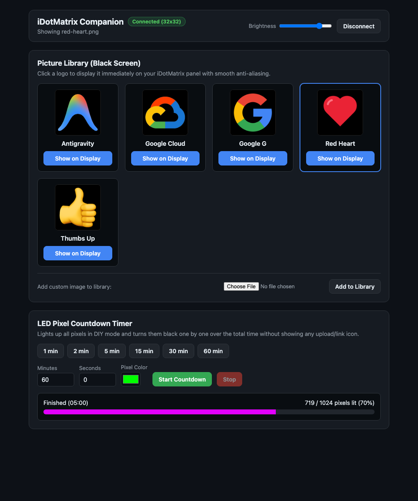

# iDotMatrix Companion

A lightweight, zero-framework-dependency Python web app for controlling your iDotMatrix LED pixel display.



## Features

1. **Pre-defined Picture Library (on a Black Screen)**
   - **Antigravity** (`library/antigravity.png`)
   - **Google Cloud** (`library/google-cloud.png`)
   - **Google G** (`library/google-g.png`)
   - **Red Heart** (`library/red-heart.png`)
   - **Thumbs Up** (`library/thumbs-up.png`)
   - One-click display using `client.image.set_mode(ImageMode.EnableDIY)` + `client.image.upload_image_file()` (`LANCZOS` anti-aliased scaling on a black background), plus browser upload to add more pictures to the library.
   - **Multi-Picture Cycling**: Select multiple pictures from the library (showing cycle order `#1`, `#2`, ...) and cycle through them automatically with a configurable delay in seconds.

2. **Full-Screen LED Pixel Countdown Timer**
   - Enters DIY mode once (`ImageMode.EnableDIY`) and lights up all pixels (`1,024` pixels on `32x32`) in your chosen color.
   - Turns pixels black (`(0, 0, 0)`) one after another aligned to `time.monotonic()` using `client.graffiti.set_pixels()` so **no upload/link icon** is ever shown between updates.
   - Real-time web progress bar showing remaining time and remaining lit pixels, with instant Stop/Cancel support.

## Quick Start

```bash
python3 -m venv .venv
source .venv/bin/activate
pip install -e .
python app.py
```

Then open **http://127.0.0.1:8080** in your browser.

### CLI Options

```bash
# Auto-discovers your iDotMatrix display by default, or pass --mac / BLE UUID:
python app.py --host 127.0.0.1 --port 8080
```
